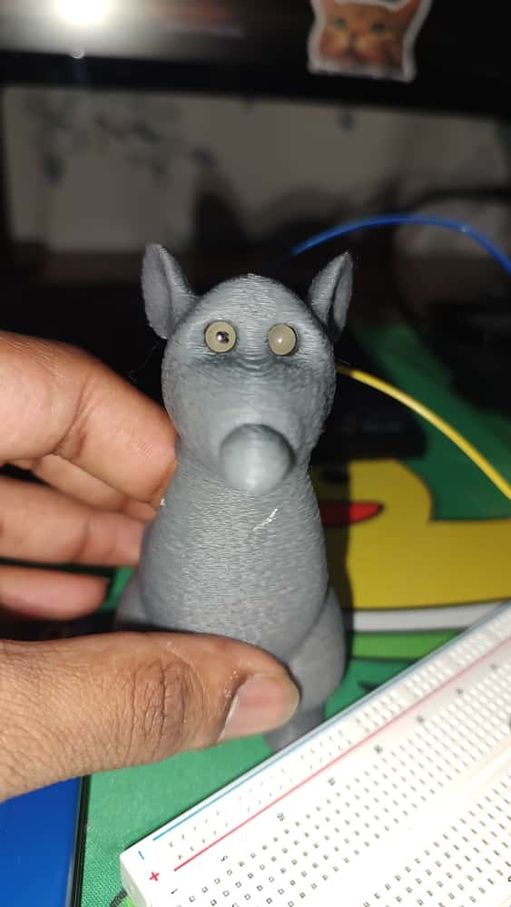

# Remy Rat Costume (Animatronic)

A fan-made, wearable Remy figure from *Ratatouille* (made for Halloween, October 2025). The 3D-printed rat has two servo-driven arms that move on their own with randomized, lifelike motion, plus two LEDs, all run by an Arduino Mega.

Made by Mouli Grandhi.

## Photos

<p align="center">
  
  &nbsp;&nbsp;
  
</p>

## Demo

*Video coming soon.*

## Features

- **Independent arm motion**: each arm servo picks a new random angle every 800 ms, so the movement looks natural instead of looping
- **Non-blocking code**: uses `millis()` timing instead of `delay()`, so more features can be added without stalling the arms
- **Glowing eyes**: two LEDs set into the head, on PWM pins 9 and 10

## Hardware

- Arduino Mega
- 2× hobby servos (arms)
- 2× LEDs (+ current-limiting resistors)
- Hookup wire
- 3D-printed parts (below)

## Wiring

| Component | Arduino Mega pin |
|---|---|
| Left arm servo (signal) | 3 |
| Right arm servo (signal) | 5 |
| LED 1 | 9 |
| LED 2 | 10 |
| Button (defined, not used yet) | 0 |

Servo power and ground go to 5V and GND. Each LED goes through a resistor to GND.

## 3D-printed parts

Printed on a **Bambu Lab A1 mini**.

| File | Approx. size (mm) |
|---|---|
| [`models/remy_body.stl`](models/remy_body.stl) | 65 × 51 × 100 |
| [`models/remy_left_arm.stl`](models/remy_left_arm.stl) | 22 × 34 × 14 |
| [`models/remy_right_arm.stl`](models/remy_right_arm.stl) | 22 × 34 × 14 |

> The STLs are saved in **meters**. If they import tiny in Bambu Studio, accept the prompt to convert units (or scale by 1000%).

## Arm motion ranges

| Servo | Range |
|---|---|
| Left arm | 75°–135° |
| Right arm | 45°–105° |

I recommend zeroing the servo first and then screwing the arms in carefully without twisting the shaft. Or change the `random(min, max)` values in the sketch to tune these.

## Uploading the code

1. Open `firmware/remy_ratatouille_cs12/remy_ratatouille_cs12.ino` in the Arduino IDE.
2. Select **Board: Arduino Mega or Mega 2560** and the correct port.
3. Upload. The built-in `Servo` library is the only dependency.

## Repo layout

```
firmware/remy_ratatouille_cs12/remy_ratatouille_cs12.ino   # Arduino sketch
models/                                                     # STL files for printing
media/                                                      # Photos
```

## Notes

- In the current sketch, the LEDs start at `analogWrite(..., 0)` (off). Set a value from 0 to 255 to change brightness (128 ≈ 50%).
- Pin 0 is also the serial RX pin. If you wire up the button, a different pin (like 2) avoids conflicts when uploading.

## Disclaimer

Fan project for personal use. Remy and *Ratatouille* are property of Disney/Pixar. This project is not affiliated with or endorsed by them.

## License

Code: [MIT](LICENSE).
